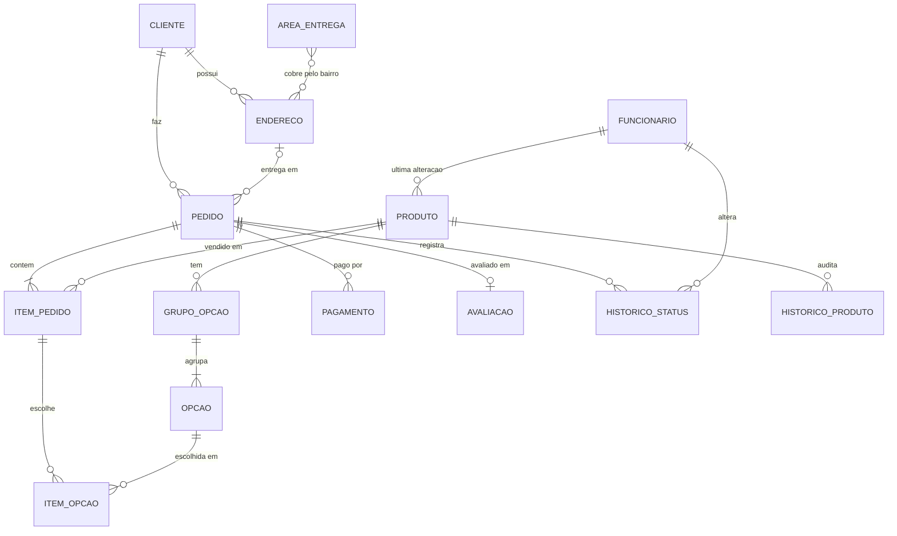

# DeliveryFácil — Explicação das Entregas (Banco de Dados + POO)

Projeto Integrador · Banco de Dados Aplicado + Programação Orientada a Objetos
Base: Documento de Visão e Levantamento de Requisitos (10 estórias) · SGBD: **SQL Server** · API: **Java 17 + Spring Boot 3**

---

## 1. O que está sendo entregue

| Entrega | Onde | Conteúdo |
|---|---|---|
| Banco de dados | `database/01_ddl_tabelas.sql` | Criação do banco e das 14 tabelas, com todas as restrições |
| | `database/02_automacao_desempenho.sql` | 2 FUNCTIONS, 4 TRIGGERS, 2 STORED PROCEDURES, 3 INDEX |
| | `database/03_dml_carga.sql` | Carga inicial (mínimo 3 registros por tabela) |
| | `database/04_consultas.sql` | 8 consultas + testes das rotinas |
| | `database/DeliveryFacil_banco_completo.sql` | Os quatro scripts concatenados, para rodar de uma vez |
| API REST (POO) | `api/` | Projeto Maven Spring Boot ligado ao SQL Server |
| Este documento | `docs/EXPLICACAO_DO_PROJETO.md` | Decisões, mapeamentos, dicionário de dados e como executar |

> **Não faz parte desta entrega:** a fila/busca binária (Estrutura de Dados), o documento de arquitetura, o protótipo Figma e o PPT. Posso gerar depois, se quiser.

---

## 2. Escolha do SGBD (justificativa)

O enunciado de POO exige **SQL Server**, então ele é o SGBD único do projeto (assim banco e API são o mesmo sistema). Também atende bem ao domínio:

- `IDENTITY(1000,10)` nativo para a autonumeração exigida.
- Transações ACID e `UPDLOCK` para evitar duas mudanças de status simultâneas no mesmo pedido.
- **Índices filtrados** (usado para garantir webhook idempotente: `id_transacao_gateway` único só quando não nulo).
- `THROW`/`TRY…CATCH` e triggers `AFTER` para regras que precisam valer mesmo fora da API.
- Atende ao requisito de 50–300 pedidos simultâneos no pico com índices de cobertura bem escolhidos.

---

## 3. Modelo de dados

### 3.1 Diagrama de entidades e relacionamentos



### 3.2 Relacionamentos N:N (exigência do enunciado)

1. **PEDIDO ⇄ PRODUTO**, resolvido pela tabela associativa `ITEM_PEDIDO` (que carrega quantidade, preço congelado e observação).
2. **ITEM_PEDIDO ⇄ OPCAO**, resolvido por `ITEM_OPCAO` (adicionais/variações escolhidos em cada item).

`AREA_ENTREGA` se liga a `ENDERECO` **pelo bairro** (relação lógica por valor, não por FK), porque o documento de visão define que um bairro fora da tabela só marca o endereço como "indisponível", sem impedir o cadastro.

### 3.3 Diferenças em relação à estrutura do Documento de Visão

Mantive as 12 tabelas e todos os campos do documento. Acrescentei **apenas o que as próprias estórias exigem** e a estrutura original não comportava:

| Acréscimo | Motivo (estória) |
|---|---|
| `HISTORICO_STATUS` (nova tabela) | E9: registrar cada mudança de status com data/hora e responsável |
| `HISTORICO_PRODUTO` (nova tabela) | E3: registrar usuário e data/hora de alteração de preço/status |
| `PRODUTO.id_funcionario_alteracao`, `data_alteracao` | E3: saber quem alterou (alimenta o trigger de auditoria) |
| `ITEM_OPCAO.preco_adicional` | E6: congelar também o preço do adicional, como é feito com o preço do item |
| `PEDIDO.motivo_cancelamento` | E9: motivo obrigatório no cancelamento |
| `ENDERECO.disponivel_entrega` | E2: marcar endereço fora da área como "indisponível para entrega" |
| `PAGAMENTO.data_criacao` | E8: medir os 15 minutos do Pix pendente |
| `AVALIACAO.data_avaliacao`, `CLIENTE.data_cadastro` | Rastreabilidade (histórico do restaurante) |

---

## 4. Atendimento aos requisitos do enunciado (checklist)

| Exigência | Como foi atendida |
|---|---|
| ≥ 5 entidades | 14 tabelas |
| ≥ 1 relacionamento N:N | `ITEM_PEDIDO` e `ITEM_OPCAO` |
| Autonumeração iniciando em 1000, incremento 10 | `PEDIDO.id_pedido IDENTITY(1000,10)` |
| PRIMARY KEY em todas | Sim, as 14 |
| FOREIGN KEY | Em todos os relacionamentos |
| FK com exclusão em cascata | `ENDERECO→CLIENTE`, `GRUPO_OPCAO→PRODUTO`, `OPCAO→GRUPO_OPCAO`, `ITEM_PEDIDO→PEDIDO`, `ITEM_OPCAO→ITEM_PEDIDO` |
| NOT NULL sempre que possível | Todos os campos obrigatórios das estórias |
| CHECK | Telefone só dígitos, e-mail com `@`, CEP, preço > 0, nota 1–5, status permitidos, `min ≤ max`, coerência entrega×endereço etc. |
| UNIQUE | `CLIENTE.telefone`, `AREA_ENTREGA.bairro`, `AVALIACAO.id_pedido`, `ITEM_OPCAO(id_item,id_opcao)` |
| DEFAULT | `telefone_verificado = 0`, `status = 'Pendente'`, `status do produto = 'ativo'`, `preco_adicional = 0`, `desconto_cupom = 0` |
| ≥ 3 registros por tabela | Script 03 |
| ALIAS, 2+ JOINs, agregações | Script 04 (C1 a C8; C7 usa 4 JOINs; C2 usa SUM, COUNT, AVG, MAX, MIN) |
| TRIGGER / FUNCTION / PROCEDURE / INDEX | Script 02 (ver seção 5) |
| Dicionário de dados | Seção 6 |

---

## 5. Automação e desempenho (script 02)

| Objeto | O que faz | Estória |
|---|---|---|
| `fn_taxa_entrega(id_endereco)` | Taxa pelo bairro; retorna `NULL` se fora da área | E2, E7 |
| `fn_subtotal_pedido(id_pedido)` | `SUM(qtd × (preço_unitário + adicionais))` | E6, E7 |
| `trg_item_pedido_recalcula` / `trg_item_opcao_recalcula` | Recalculam `subtotal_produtos` e `valor_total = subtotal + taxa − cupom` ao inserir/alterar/remover itens | E6, E7 |
| `trg_produto_auditoria` | Só **gestor** altera preço/status; grava `HISTORICO_PRODUTO` | E3 |
| `trg_avaliacao_valida_entrega` | Bloqueia avaliação se o pedido não está "Entregue" | E10 |
| `sp_atualizar_status_pedido` | Valida o fluxo (Pagamento aprovado → Aceito → Em preparo → Pronto → Entregue), exige motivo no cancelamento, restringe o cliente a "Pendente" e grava histórico, tudo em uma transação | E9 |
| `sp_cancelar_pix_expirados` | Cancela pedidos com Pix pendente há mais de 15 min | E8 |
| `ix_pedido_cliente_data` | `(id_cliente, data_pedido DESC)` + `INCLUDE`: histórico do cliente | `PEDIDO` é a tabela mais consultada |
| `ix_pedido_status_data` | `(status, data_pedido)`: colunas do painel do restaurante | idem |
| `ix_item_pedido_pedido` | `(id_pedido)`: junção itens→pedido | idem |

**Ordem de execução:** o script 02 vem **antes** da carga (03) porque a carga usa `fn_taxa_entrega` e deixa os totais dos pedidos serem calculados pelos triggers, que é a melhor prova de que eles funcionam.

---

## 6. Dicionário de dados

Legenda: **PK** chave primária · **FK** chave estrangeira · **UQ** único · **NN** não nulo · **DF** default · **CK** check

### CLIENTE
| Campo | Tipo | Restrições |
|---|---|---|
| id_cliente | INT IDENTITY(1,1) | PK |
| nome | VARCHAR(100) | NN |
| telefone | VARCHAR(15) | NN, UQ, CK (só dígitos, 10–11) |
| email | VARCHAR(150) | CK (contém `@`) |
| telefone_verificado | BIT | NN, DF 0 |
| data_cadastro | DATETIME2 | NN, DF `SYSDATETIME()` |

### ENDERECO
| Campo | Tipo | Restrições |
|---|---|---|
| id_endereco | INT IDENTITY | PK |
| id_cliente | INT | FK→CLIENTE, NN, **ON DELETE CASCADE** |
| rua / numero / bairro | VARCHAR(150/10/100) | NN |
| complemento / referencia | VARCHAR(100/150) | opcionais |
| cep | VARCHAR(9) | NN, CK (`00000-000`) |
| latitude / longitude | DECIMAL(9,6) | NN, CK (faixas válidas) |
| disponivel_entrega | BIT | NN, DF 1 |

### AREA_ENTREGA
| Campo | Tipo | Restrições |
|---|---|---|
| id_area | INT IDENTITY | PK |
| bairro | VARCHAR(100) | NN, UQ |
| taxa_entrega | DECIMAL(10,2) | NN, CK ≥ 0 |
| pedido_minimo | DECIMAL(10,2) | NN, DF 0, CK ≥ 0 |

### FUNCIONARIO
| Campo | Tipo | Restrições |
|---|---|---|
| id_funcionario | INT IDENTITY | PK |
| nome | VARCHAR(100) | NN |
| papel | VARCHAR(10) | NN, CK (`operador`/`gestor`) |

### PRODUTO
| Campo | Tipo | Restrições |
|---|---|---|
| id_produto | INT IDENTITY | PK |
| nome | VARCHAR(100) | NN, CK (não vazio) |
| descricao | VARCHAR(MAX) | opcional |
| preco | DECIMAL(10,2) | NN, CK > 0 |
| categoria | VARCHAR(50) | NN |
| foto_url | VARCHAR(255) | opcional |
| status | VARCHAR(10) | NN, DF `ativo`, CK (`ativo`/`pausado`) |
| id_funcionario_alteracao | INT | FK→FUNCIONARIO |
| data_alteracao | DATETIME2 | opcional |

### HISTORICO_PRODUTO
| Campo | Tipo | Restrições |
|---|---|---|
| id_historico_produto | INT IDENTITY | PK |
| id_produto | INT | FK→PRODUTO, NN, ON DELETE CASCADE |
| id_funcionario | INT | FK→FUNCIONARIO |
| preco_anterior / preco_novo | DECIMAL(10,2) | NN |
| status_anterior / status_novo | VARCHAR(10) | NN |
| data_alteracao | DATETIME2 | NN, DF `SYSDATETIME()` |

### GRUPO_OPCAO
| Campo | Tipo | Restrições |
|---|---|---|
| id_grupo_opcao | INT IDENTITY | PK |
| id_produto | INT | FK→PRODUTO, NN, ON DELETE CASCADE |
| nome | VARCHAR(50) | NN |
| obrigatorio | BIT | NN, DF 0 |
| min_selecoes / max_selecoes | INT | NN, DF 0 / 1, CK `min ≤ max`; se obrigatório, `min ≥ 1` |

### OPCAO
| Campo | Tipo | Restrições |
|---|---|---|
| id_opcao | INT IDENTITY | PK |
| id_grupo_opcao | INT | FK→GRUPO_OPCAO, NN, ON DELETE CASCADE |
| nome | VARCHAR(50) | NN |
| preco_adicional | DECIMAL(10,2) | NN, DF 0, CK ≥ 0 |

### PEDIDO
| Campo | Tipo | Restrições |
|---|---|---|
| id_pedido | INT **IDENTITY(1000,10)** | PK |
| id_cliente | INT | FK→CLIENTE, NN |
| id_endereco | INT | FK→ENDERECO; nulo se retirada |
| tipo_entrega | VARCHAR(10) | NN, CK (`entrega`/`retirada`) |
| data_pedido | DATETIME2 | NN, DF `SYSDATETIME()` |
| status | VARCHAR(30) | NN, DF `Pendente`, CK (7 status) |
| subtotal_produtos / taxa_entrega / desconto_cupom / valor_total | DECIMAL(10,2) | NN, DF 0, CK ≥ 0 |
| motivo_cancelamento | VARCHAR(200) | CK: obrigatório se `Cancelado` |
| — | — | CK: entrega ⇒ endereço; retirada ⇒ sem endereço |

### ITEM_PEDIDO
| Campo | Tipo | Restrições |
|---|---|---|
| id_item | INT IDENTITY | PK |
| id_pedido | INT | FK→PEDIDO, NN, ON DELETE CASCADE |
| id_produto | INT | FK→PRODUTO, NN |
| quantidade | INT | NN, CK > 0 |
| preco_unitario | DECIMAL(10,2) | NN, CK ≥ 0 (congelado) |
| observacao | VARCHAR(200) | opcional |

### ITEM_OPCAO
| Campo | Tipo | Restrições |
|---|---|---|
| id_item_opcao | INT IDENTITY | PK |
| id_item | INT | FK→ITEM_PEDIDO, NN, ON DELETE CASCADE |
| id_opcao | INT | FK→OPCAO, NN |
| preco_adicional | DECIMAL(10,2) | NN, DF 0 (congelado) |
| — | — | UQ (id_item, id_opcao) |

### PAGAMENTO
| Campo | Tipo | Restrições |
|---|---|---|
| id_pagamento | INT IDENTITY | PK |
| id_pedido | INT | FK→PEDIDO, NN |
| forma_pagamento | VARCHAR(10) | NN, CK (`pix`/`cartao`) |
| status_pagamento | VARCHAR(10) | NN, DF `aguardando`, CK (4 valores) |
| valor | DECIMAL(10,2) | NN, CK > 0 |
| id_transacao_gateway | VARCHAR(100) | índice único filtrado (não nulos); **sem dados de cartão** |
| data_criacao | DATETIME2 | NN, DF `SYSDATETIME()` |

### AVALIACAO
| Campo | Tipo | Restrições |
|---|---|---|
| id_avaliacao | INT IDENTITY | PK |
| id_pedido | INT | FK→PEDIDO, NN, **UQ** (uma por pedido) |
| nota | INT | NN, CK 1–5 |
| comentario / resposta_restaurante | VARCHAR(MAX) | opcionais |
| data_avaliacao | DATETIME2 | NN, DF `SYSDATETIME()` |

### HISTORICO_STATUS
| Campo | Tipo | Restrições |
|---|---|---|
| id_historico_status | INT IDENTITY | PK |
| id_pedido | INT | FK→PEDIDO, NN, ON DELETE CASCADE |
| status_anterior / status_novo | VARCHAR(30) | NN |
| data_alteracao | DATETIME2 | NN, DF `SYSDATETIME()` |
| id_funcionario | INT | FK→FUNCIONARIO; nulo = cliente/sistema |
| motivo | VARCHAR(200) | opcional |

---

## 7. API REST (POO)

### 7.1 Organização

```
api/src/main/java/br/com/deliveryfacil
├── DeliveryFacilApplication.java
├── config/       OpenApiConfig (Swagger)
├── controller/   9 controllers: só HTTP e conversão para DTO
├── dto/          Records com Bean Validation + fábricas  Resposta.de(entidade)
├── exception/    ApiException (abstrata) + 6 subclasses + GlobalExceptionHandler
├── model/        Entidades JPA; Pessoa (abstrata); enums/ com conversores
├── repository/   Spring Data JPA
└── service/      Regras de negócio; service/pagamento/ com as estratégias de pagamento
```

### 7.2 Conceitos de POO aplicados

| Critério | Onde está |
|---|---|
| **Classe abstrata + herança** | `Pessoa` (abstrata, `@MappedSuperclass`) → `Cliente`, `Funcionario`, com o método abstrato `descricaoPapel()` |
| **Classe abstrata + herança** | `ApiException` (abstrata) → `RecursoNaoEncontradoException` (404), `ConflitoException` (409), `RegraNegocioException` (422), `AcessoNegadoException` (403), `NaoAutenticadoException` (401), `ServicoIndisponivelException` (503) |
| **Polimorfismo / Template Method** | `ProcessadorPagamento` (abstrata, método `criar` final) → `PixProcessador` (expira em 15 min) e `CartaoProcessador` |
| **Reaproveitamento de código** | `ConversorRotulo<E>` genérico: um único conversor serve a 6 enums (`StatusPedido`, `TipoEntrega`, …) gravados como texto do banco |
| **Encapsulamento** | Cálculos dentro das entidades (`Pedido.recalcularTotais()`, `ItemPedido.subtotal()`) e `StatusPedido.proximo()` concentra o fluxo permitido |
| **Bibliotecas complementares** | Lombok, Bean Validation, springdoc-openapi (Swagger), Spring Scheduling |

### 7.3 Verbos HTTP e endpoints

| Recurso | Endpoints |
|---|---|
| Clientes | `POST/GET /api/clientes` · `GET/PUT/DELETE /api/clientes/{id}` · `POST /{id}/otp` · `PATCH /{id}/telefone-verificado` |
| Endereços | `POST/GET /api/clientes/{id}/enderecos` · `PUT/DELETE /api/enderecos/{id}` |
| Áreas de entrega | `POST/GET /api/areas-entrega` · `PUT/DELETE /{id}` (gestor) |
| Funcionários | `POST/GET /api/funcionarios` |
| Produtos | `POST/GET /api/produtos` · `GET/PUT /{id}` · `PATCH /{id}/status` (gestor) |
| Grupos de opção | `POST/GET /api/produtos/{id}/grupos` · `DELETE /api/grupos/{id}` (gestor) |
| Pedidos | `POST/GET /api/pedidos` · `GET /{id}` · `POST /{id}/itens` · `DELETE /{id}/itens/{idItem}` · `PATCH /{id}/cupom` · `PATCH /{id}/status` (funcionário) · `POST /{id}/cancelamento` (cliente) · `GET /{id}/historico` |
| Pagamentos | `POST/GET /api/pedidos/{id}/pagamentos` · `POST /api/pagamentos/webhook` |
| Avaliações | `POST /api/pedidos/{id}/avaliacao` · `GET /api/avaliacoes` · `PATCH /api/avaliacoes/{id}/resposta` |

Documentação interativa: `http://localhost:8080/swagger-ui.html`. Rotas de funcionário exigem o cabeçalho `X-Funcionario-Id`.

### 7.4 Regras de negócio além do CRUD

- **Cliente:** telefone único e só números com DDD; OTP de 6 dígitos com validade de 5 min; só pode fazer pedido com telefone verificado.
- **Endereço:** CEP normalizado; bairro fora de `AREA_ENTREGA` ⇒ `disponivelEntrega = false` (retirada continua permitida).
- **Produto:** só gestor cria/edita/pausa; produto pausado não entra no carrinho.
- **Grupos:** `min ≤ max`; obrigatório exige `min ≥ 1`; `max` não pode exceder o número de opções.
- **Pedido:** nasce `Pendente`, sem itens; entrega exige endereço do próprio cliente dentro da cobertura; taxa vem do bairro; retirada = taxa 0.
- **Itens:** produto ativo; opções devem pertencer ao produto; grupo obrigatório exige seleção; respeita min/max; **preço e adicionais congelados**; totais recalculados.
- **Cupom:** `DELIVERY5` (R$ 5) e `PRIMEIRA10` (R$ 10), fixos para demonstração.
- **Pagamento:** exige itens e pedido mínimo do bairro; bloqueia segundo pagamento enquanto houver um aguardando/aprovado; **webhook idempotente**; aprovação move o pedido para "Pagamento aprovado"; recusa notifica e permite nova tentativa; **Pix > 15 min cancela o pedido** (job agendado).
- **Status:** fluxo fixo; cancelar pelo restaurante exige motivo; cliente só cancela em "Pendente"; cada mudança grava histórico e notifica; job alerta pedidos acima do SLA de preparo (30 min).
- **Avaliação:** só em pedido "Entregue", uma por pedido, com resposta pública do restaurante.

### 7.5 Tratamento de erros (4xx e 5xx)

Corpo padrão `{timestamp, status, erro, mensagem, caminho, detalhes[]}`.

| Status | Quando |
|---|---|
| 400 | Validação (`@Valid`), JSON malformado, parâmetro inválido |
| 401 / 403 | Sem `X-Funcionario-Id` / papel sem permissão |
| 404 | Recurso inexistente (ou rota inexistente) |
| 405 / 415 | Método ou tipo de conteúdo não suportado |
| 409 | Telefone duplicado, pagamento duplicado, violação de integridade no banco |
| 422 | Regra de negócio violada |
| 500 | Erro inesperado (detalhe só no log) |
| 503 | Banco indisponível |

---

## 8. Como executar

**Pré-requisitos:** SQL Server 2019+ (ou Docker), JDK 17, Maven 3.9+.

```bash
# 1) SQL Server em Docker (opcional)
docker run -e ACCEPT_EULA=Y -e MSSQL_SA_PASSWORD='SuaSenha@123' -p 1433:1433 -d mcr.microsoft.com/mssql/server:2022-latest

# 2) Banco: rode os scripts na ordem 01 → 02 → 03 → 04 (SSMS/Azure Data Studio),
#    ou o arquivo DeliveryFacil_banco_completo.sql de uma vez.
#    Com sqlcmd use -f 65001 para preservar acentos.

# 3) API
cd api
export DB_USER=sa DB_PASSWORD='SuaSenha@123'
mvn spring-boot:run
```

**Roteiro de teste rápido (fluxo feliz):**
1. `POST /api/funcionarios` (gestor) → `POST /api/areas-entrega`
2. `POST /api/clientes` → `POST /api/clientes/{id}/otp` (veja o código no log) → `PATCH …/telefone-verificado`
3. `POST /api/clientes/{id}/enderecos` → `POST /api/produtos` → `POST /api/produtos/{id}/grupos`
4. `POST /api/pedidos` → `POST /api/pedidos/{id}/itens` → `POST /api/pedidos/{id}/pagamentos`
5. `POST /api/pagamentos/webhook` com `{"idTransacaoGateway":"…","status":"aprovado"}` (repita para ver a idempotência)
6. `PATCH /api/pedidos/{id}/status` com `Aceito → Em preparo → Pronto/Saiu para entrega → Entregue` → `POST …/avaliacao`

---

## 9. Decisões de projeto e limitações (leia antes de apresentar)

1. **Código não compilado neste ambiente.** O ambiente de geração não tem JDK nem acesso ao Maven Central, e o SQL Server não foi executado aqui. O código foi escrito com cuidado, mas **rode `mvn clean package` e o script SQL primeiro** e corrija qualquer ajuste fino de dependência/versão antes da entrega.
2. **Regras duplicadas de propósito (defesa em profundidade):** totais, fluxo de status e restrições existem no banco (triggers/CHECK/procedures) **e** na API. O banco protege contra acesso direto; a API dá mensagens amigáveis (4xx).
3. **Integrações simuladas:** gateway de pagamento (só gera o ID da transação), SMS do OTP (vai para o log), notificações push/WhatsApp (log) e geocodificação (latitude/longitude vêm na requisição). Cada uma está isolada em uma classe/serviço, pronta para trocar por a integração real.
4. **Autenticação simplificada:** o cabeçalho `X-Funcionario-Id` representa o papel. Em produção, use Spring Security + JWT e valide a assinatura do webhook.
5. **LGPD:** `DELETE /api/clientes/{id}` remove cliente e endereços (cascata). Clientes com pedidos recebem 409; o próximo passo seria anonimizar em vez de excluir, preservando o histórico financeiro.
6. **Estado em memória:** os códigos OTP ficam em memória (perdem-se ao reiniciar e não escalam para várias instâncias). Em produção, usar Redis.
7. **`open-in-view` ligado** para simplificar o mapeamento para DTO; em produção, mapear dentro dos services e desligar.
8. **Valores monetários** em `DECIMAL(10,2)`/`BigDecimal`, nunca `float`.
9. **Cupons** são fixos no código porque o documento de visão não define tabela de cupons.
"# pi" 
